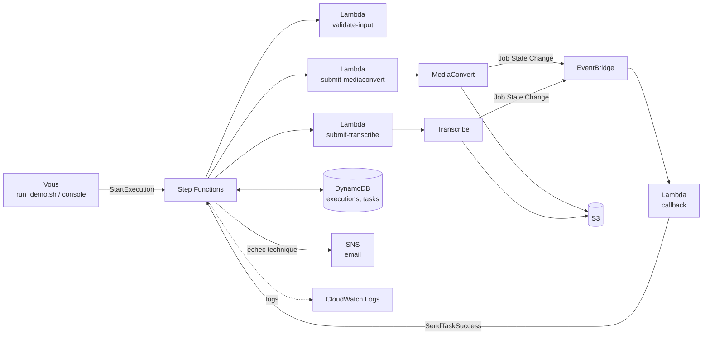

# POC – Transcription de fichiers audio/vidéo sur AWS

Ce dossier contient tout ce qu'il faut pour déployer et présenter un POC de transcription : un fichier audio ou vidéo est transcodé en audio de haute qualité (**AWS Elemental MediaConvert**), puis transcrit (**Amazon Transcribe**), le tout orchestré par **AWS Step Functions**. Il est autonome : il ne dépend d'aucun autre dossier du projet.

> **Statut de validation.** Le code a été testé en unitaire (services AWS simulés) et les scripts ont été vérifiés hors ligne (`scripts/00_check.sh`, mode simulation `DRY_RUN=1`). **Le POC n'a pas encore été déployé sur un compte AWS** : le premier déploiement est aussi sa première validation de bout en bout. Si une étape échoue, voir la section « En cas de problème ».

## 1. Ce que montre le POC

1. Un fichier est déposé dans S3 et une exécution Step Functions est démarrée.
2. Une Lambda vérifie le fichier (présent, non vide, extension et bucket autorisés).
3. Une Lambda détecte si l'audio est mono ou stéréo, puis lance un job MediaConvert qui produit :
   - un **FLAC** sans perte (entrée de Transcribe, pour la précision) ;
   - un **MP4/AAC** de lecture.
4. La state machine se met en **pause** (attente par jeton) ; à la fin du job, **EventBridge** déclenche une Lambda de rappel qui la réveille.
5. Une Lambda lance un job **Transcribe** sur le FLAC (même mécanisme de pause et de rappel).
6. Le résultat (statut, fichiers, transcription JSON) est dans DynamoDB et S3.
7. En cas d'erreur : un échec dû au fichier est signalé sans alerte (statut `FAILED`) ; un échec technique envoie un **email SNS** à l'équipe.



Le flux de la state machine est expliqué état par état dans [docs/STATE_MACHINE.md](docs/STATE_MACHINE.md), les tables DynamoDB et les règles EventBridge dans [docs/DATA_AND_EVENTS.md](docs/DATA_AND_EVENTS.md). Le détail de chaque composant est dans [docs/COMPONENTS.md](docs/COMPONENTS.md), le scénario de présentation dans [docs/DEMO.md](docs/DEMO.md) et le déploiement manuel (CLI ou console) dans [docs/MANUAL_DEPLOYMENT.md](docs/MANUAL_DEPLOYMENT.md).

## 2. Contenu du dossier

```
poc/
  README.md                  ce fichier
  docs/
    COMPONENTS.md            détail technique de chaque composant
    DEMO.md                  déroulé d'une présentation à l'équipe
    MANUAL_DEPLOYMENT.md     déploiement manuel (commandes AWS CLI ou console AWS)
    RUN_FROM_CONSOLE.md      lancer un traitement depuis la console Step Functions, avec un fichier déjà dans S3
    STATE_MACHINE.md         le flux de la state machine expliqué état par état
    DATA_AND_EVENTS.md       tables DynamoDB et règles EventBridge expliquées
  lambdas/                   code des 4 Lambdas (+ tests unitaires)
    validate_input/  submit_mediaconvert/  submit_transcribe/  callback/
  state_machine/             définition de la state machine (modèle)
  mediaconvert/              3 templates de job (mono, stéréo conservée, stéréo fusionnée)
  iam/                       relations de confiance et politiques (modèles)
  dynamodb/                  définition des 2 tables (modèles)
  events/                    motifs des 2 règles EventBridge
  scripts/                   déploiement, démonstration, nettoyage
```

Les fichiers `*.tpl` contiennent des marqueurs (`__PREFIX__`, `__ACCOUNT_ID__`, `__REGION__`, `__BUCKET__`) remplacés au déploiement : rien n'est écrit en dur pour un compte donné.

## 3. Prérequis

| Besoin | Détail |
|---|---|
| Compte AWS | Avec les services MediaConvert, Transcribe, Step Functions, Lambda, DynamoDB, SNS, EventBridge et S3 disponibles dans la région choisie |
| Droits de la personne qui déploie | Création de rôles IAM, Lambda, tables DynamoDB, topic SNS, règles EventBridge, state machine, bucket S3. Un rôle administrateur est le plus simple |
| AWS CLI v2 | Configurée sur le compte (`aws configure` ou `aws configure sso`). Vérifier : `aws sts get-caller-identity` |
| Bash | Linux/macOS : natif. Windows : **Git Bash** (fourni avec Git for Windows). Les commandes ci-dessous se lancent depuis Bash |
| Python 3.8+ | Pour empaqueter les Lambdas, construire la layer et afficher les résultats |
| Accès Internet | Pour télécharger le binaire `ffprobe` (environ 40 Mo) lors de la construction de la layer |
| Une adresse email | Destinataire des alertes (l'abonnement SNS doit être confirmé) |

## 4. Démarrage rapide

```bash
cd poc
export ALERT_EMAIL=vous@exemple.com      # adresse qui recevra les alertes

bash scripts/00_check.sh                 # facultatif : contrôles hors ligne, sans appel AWS
bash scripts/deploy_all.sh               # déploie tout (quelques minutes)
```

Puis :

1. **Confirmer l'abonnement email** : AWS envoie un message « Subscription Confirmation » à `ALERT_EMAIL`. Sans confirmation, aucune alerte n'arrive.
2. Lancer une démonstration avec un court fichier audio (30 à 90 secondes de parole) :

```bash
bash scripts/run_demo.sh mon-fichier.mp3
```

Le script envoie le fichier, démarre l'exécution, affiche l'avancement, puis la transcription.

Pour relire ce que le déploiement va créer sans rien exécuter : `DRY_RUN=1 bash scripts/deploy_all.sh`.

**Sans les scripts** : le déploiement manuel, étape par étape, avec les commandes AWS CLI ou la console AWS, est décrit dans [docs/MANUAL_DEPLOYMENT.md](docs/MANUAL_DEPLOYMENT.md).

### Étapes du déploiement

`deploy_all.sh` enchaîne ces scripts, qu'on peut aussi lancer un par un :

| Script | Rôle |
|---|---|
| `01_storage.sh` | Bucket S3, templates MediaConvert, tables DynamoDB, topic SNS et abonnement email |
| `02_iam.sh` | Six rôles IAM (quatre Lambdas, state machine, MediaConvert) |
| `03_layer.sh` | Layer `ffprobe` (téléchargement vérifié par empreinte MD5, droits d'exécution inclus), publiée via S3 |
| `04_lambdas.sh` | Empaquette et déploie les quatre Lambdas |
| `05_state_machine.sh` | Crée la state machine, avec journalisation CloudWatch |
| `06_events.sh` | Deux règles EventBridge vers la Lambda de rappel |

Les scripts sont **réexécutables** : ce qui existe est mis à jour. Les identifiants produits sont mémorisés dans `.state.env`.

### Paramètres (variables d'environnement)

| Variable | Défaut | Rôle |
|---|---|---|
| `ALERT_EMAIL` | (obligatoire) | Destinataire des alertes |
| `PREFIX` | `stt-poc` | Préfixe de toutes les ressources (permet de déployer plusieurs POC sans collision) |
| `AWS_REGION` | région du profil AWS CLI, sinon `eu-central-1` | Région de déploiement |
| `POC_BUCKET` | `<PREFIX>-<compte>-<région>` | Bucket S3 : créé s'il n'existe pas, réutilisé sinon |
| `FFPROBE_LAYER_ARN` | (aucune) | Utiliser une layer ffprobe existante au lieu d'en construire une |
| `FFPROBE_BINARY` | (aucune) | Utiliser votre propre binaire ffprobe statique Linux |
| `DRY_RUN` | `0` | `1` : affiche les commandes sans les exécuter |

## 5. Lancer une démonstration

```bash
bash scripts/run_demo.sh <fichier local | s3://bucket/chemin> [options]
```

Le fichier peut être **local** (il est envoyé dans le bucket du POC) ou **déjà dans S3** : s'il est dans le bucket du POC, il est utilisé tel quel ; s'il est dans un autre bucket, il est copié dans celui du POC (copie côté S3, sans téléchargement). Le POC ne lit que son propre bucket, d'où cette copie.

| Option | Effet |
|---|---|
| `--lang fr-FR` | Langue (défaut `fr-FR`) ; `auto` pour la détection automatique |
| `--stereo downmix\|keep` | Pour une entrée stéréo : fusion en mono (défaut) ou conservation des deux canaux (identification de canaux) |
| `--speakers N` | Active la diarisation (2 à 30 locuteurs) ; incompatible avec `--stereo keep` |
| `--vocab NOM` | Vocabulaire personnalisé Transcribe existant |
| `--download DOSSIER` | Copie les fichiers produits dans ce dossier |
| `--no-wait` | Démarre sans attendre la fin |

Pour démarrer une exécution **depuis la console Step Functions** avec un fichier déjà dans S3, voir [docs/RUN_FROM_CONSOLE.md](docs/RUN_FROM_CONSOLE.md).

Le déroulé complet d'une présentation (scénarios nominal, mono/stéréo, locuteurs, échec métier, échec technique avec email) est dans [docs/DEMO.md](docs/DEMO.md).

## 6. Où regarder les résultats

| Où | Quoi |
|---|---|
| Console **Step Functions** > `<PREFIX>-pipeline` > exécution | Le graphe animé, les entrées et sorties de chaque étape (le lien est affiché par `run_demo.sh`) |
| **DynamoDB** > `<PREFIX>-executions` | Le statut métier (`PENDING`, `VALIDATING`, `TRANSCODING`, `TRANSCRIBING`, `DONE`, `FAILED`), les chemins des sorties, l'erreur |
| **DynamoDB** > `<PREFIX>-tasks` | Les jetons d'attente (une ligne pendant qu'un job tourne, supprimée à la fin) |
| **S3** > le bucket | `input/demo/` (fichier envoyé), `output/<id>/` (FLAC et MP4), `transcripts/<id>/transcript.json` |
| **MediaConvert** > Jobs, **Transcribe** > Transcription jobs | Les jobs eux-mêmes |
| **CloudWatch** > Logs | `/aws/lambda/<PREFIX>-*` et `/aws/vendedlogs/states/<PREFIX>-pipeline` |
| **EventBridge** > Rules | Les deux règles et leurs invocations |
| Boîte mail | Les alertes SNS (échecs techniques uniquement) |

## 7. Durée et coût

- Pour un fichier d'une minute, l'exécution complète prend **quelques minutes** (démarrage du job MediaConvert, puis du job Transcribe). Durée à mesurer lors du premier essai.
- Le coût est **à l'usage** et faible pour des fichiers courts : MediaConvert est facturé à la minute de sortie (ici deux sorties : FLAC et MP4), Transcribe à la durée audio. Aucun serveur ne reste allumé ; Lambda, Step Functions, DynamoDB (à la demande), EventBridge et SNS sont négligeables à ce volume. Vérifier les tarifs actuels dans la région choisie.
- Penser à lancer `scripts/destroy.sh` quand le POC n'est plus utile.

## 8. En cas de problème

| Symptôme | Où chercher |
|---|---|
| Un script s'arrête avec `AccessDenied` | Droits de la personne qui déploie |
| `role cannot be assumed` / `cannot be assumed by Lambda` juste après la création des rôles | Propagation IAM : relancer le script (il réessaie automatiquement quelques fois) |
| Le bucket existe déjà (nom pris) | Un nom de bucket est unique mondialement : définir `POC_BUCKET` |
| L'exécution reste bloquée en `TRANSCODING` | Console MediaConvert : le job est-il terminé ? Console EventBridge : la règle `<PREFIX>-mediaconvert-job-state` a-t-elle été invoquée ? Logs de `<PREFIX>-callback` : événement reçu ? (message « no execution_id », « no pending task »...) ; table `<PREFIX>-tasks` : le jeton est-il présent ? L'exécution se termine seule en échec technique au bout de 15 minutes (délai du POC) |
| Même chose en `TRANSCRIBING` | Idem avec la règle `<PREFIX>-transcribe-job-state` et la console Transcribe (délai du POC : 30 minutes) |
| `ffprobe` : `Permission denied` | La layer n'a pas les droits d'exécution : `FORCE=1 bash scripts/03_layer.sh` (le script écrit les droits 755 dans l'archive) |
| Échec technique dès la validation | Logs de `<PREFIX>-validate-input` ; vérifier qu'aucune panne volontaire n'est active (`scripts/demo_failure.sh fix`) |
| Pas d'email d'alerte | Abonnement SNS non confirmé ; dossier courrier indésirable |
| `Invalid ... SampleRate` ou erreur de paramètre MediaConvert | Journal de la Lambda `<PREFIX>-submit-mediaconvert` et détail du job dans la console |
| Accents illisibles dans le terminal | Terminal en UTF-8 (Git Bash : Options > Text > Locale `fr_FR`, charset `UTF-8`) |

### Points à surveiller au premier déploiement

Ces comportements ont été déduits de la documentation AWS et n'ont pas encore été vus sur un compte réel :

1. **Noms des champs des événements EventBridge** (`userMetadata`, `outputFilePaths`, `errorCode`, `TranscriptionJobName`) lus par la Lambda `callback`. En cas de différence, c'est la première cause possible d'une exécution bloquée.
2. **Exception relancée dans une étape en attente de jeton** : on suppose qu'elle fait échouer l'étape immédiatement ; sinon l'échec n'apparaît qu'au délai maximal de l'étape.
3. **Droit `mediaconvert:CreateJob`** : le POC l'autorise sur toutes les ressources.
4. **Erreurs de requête Transcribe** (`BadRequestException`) classées en échec lié à la requête.

## 9. Nettoyage

```bash
bash scripts/destroy.sh          # demande de retaper le préfixe pour confirmer
```

Supprime la state machine, les règles, les Lambdas, la layer, les tables, le topic, les rôles, les groupes de logs, et vide le bucket (le supprime s'il a été créé par le POC).

## 10. Limites du POC et suite

Volontairement absents pour garder le POC simple :

| Non inclus | Conséquence |
|---|---|
| API et authentification (pas d'API Gateway, ni Cognito) | L'exécution se démarre depuis le script ou la console Step Functions |
| Envoi de fichiers par les utilisateurs, contrôle de propriété | `run_demo.sh` dépose le fichier directement dans S3 |
| Notifications temps réel, transcription en direct | Le suivi se fait par la console ou `run_demo.sh` |
| Alarmes CloudWatch, files d'attente d'échec, tableau de bord | Seuls les logs et l'email SNS d'échec technique |
| Gestion fine des quotas Transcribe/MediaConvert | Une erreur de quota est un échec technique, sans nouvelle tentative |

Choix propres au POC : un seul bucket (préfixes `input/`, `templates/`, `output/`, `transcripts/`), délais d'attente raccourcis (MediaConvert 15 min, Transcribe 30 min, exécution 1 h), tables sans protection contre la suppression, droit `CreateJob` large, journaux conservés 14 jours.

La version complète prévue (API, authentification, envoi présigné, notifications WebSocket, supervision, transcription en temps réel) est décrite dans le projet dont ce POC est extrait.
