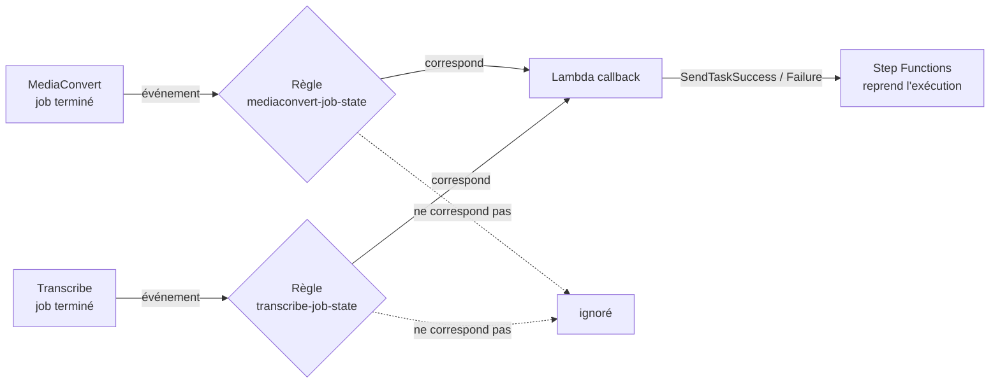

# Tables DynamoDB et règles EventBridge

Ce document explique deux familles de fichiers du POC :

- les **modèles de tables DynamoDB** : [`dynamodb/tasks.json.tpl`](../dynamodb/tasks.json.tpl) et [`dynamodb/executions.json.tpl`](../dynamodb/executions.json.tpl) ;
- les **motifs d'événements EventBridge** : [`events/mediaconvert-pattern.json`](../events/mediaconvert-pattern.json) et [`events/transcribe-pattern.json.tpl`](../events/transcribe-pattern.json.tpl).

Le flux de la state machine est expliqué à part, dans [STATE_MACHINE.md](STATE_MACHINE.md).

## 1. Pourquoi des fichiers `.tpl` ?

L'extension `.tpl` (modèle) signale qu'un fichier contient des marqueurs à remplacer avant utilisation :

| Marqueur | Remplacé par |
|---|---|
| `__PREFIX__` | le préfixe des ressources, `stt-poc` par défaut |

Le script `01_storage.sh` (tables) et `06_events.sh` (règles) produisent la version finale dans `build/` avant de l'envoyer à AWS. Un fichier sans marqueur (`mediaconvert-pattern.json`) n'a pas besoin de l'extension `.tpl` et est utilisé tel quel.

---

# Partie A : les tables DynamoDB

Le POC utilise deux tables, toutes deux **à la demande** (aucune capacité à régler, facturation à l'usage). DynamoDB n'impose de déclarer que les **clés** : les autres attributs apparaissent librement à l'écriture, c'est pourquoi les fichiers `.tpl` ne les listent pas. Ils sont décrits plus bas.

## 2. Lire un fichier de définition de table

Les deux fichiers ont la même forme (format de la commande `aws dynamodb create-table`) :

| Clé du fichier | Rôle |
|---|---|
| `TableName` | Nom de la table : `__PREFIX__-tasks` ou `__PREFIX__-executions` |
| `AttributeDefinitions` | Type des attributs qui servent de clés. `S` = chaîne de caractères |
| `KeySchema` | Les clés de la table. `HASH` = **clé de partition**, `RANGE` = **clé de tri** |
| `BillingMode` | `PAY_PER_REQUEST` : à la demande |
| `Tags` | Étiquette `project = stt-poc`, pour repérer les ressources (coûts, nettoyage) |

Une **clé de partition** identifie une ligne ; avec une **clé de tri**, la ligne est identifiée par le couple des deux, ce qui permet de ranger plusieurs lignes sous un même identifiant.

## 3. `tasks.json.tpl` : la table des jetons d'attente

### Rôle

Quand la state machine attend la fin d'un job (MediaConvert ou Transcribe), elle fournit un **jeton** à la Lambda. Ce jeton doit être retrouvé plus tard, quand EventBridge annonce la fin du job, pour **réveiller** la bonne exécution. Cette table fait le lien : elle conserve le jeton le temps de l'attente.

### Clés

| Attribut | Type | Rôle de clé | Contenu |
|---|---|---|---|
| `execution_id` | chaîne | partition | L'identifiant du traitement |
| `stage` | chaîne | tri | `MEDIACONVERT` ou `TRANSCRIBE` |

La clé composée permet à un même traitement d'avoir deux lignes (une par étape d'attente) sans conflit : `(demo-1, MEDIACONVERT)` puis `(demo-1, TRANSCRIBE)`.

### Une ligne type (pendant l'attente du job MediaConvert)

```json
{
  "execution_id": "demo-1",
  "stage": "MEDIACONVERT",
  "task_token": "AQCwAAAAKgAAAAMAAAAA...",
  "created_at": "2026-10-27T18:35:21+00:00",
  "ttl": 1793212521,
  "channels": 1,
  "template": "mono",
  "stereo_mode": null,
  "output_destination": "s3://stt-poc-123/output/demo-1/"
}
```

| Attribut | Écrit par | Rôle |
|---|---|---|
| `task_token` | `submit-mediaconvert` ou `submit-transcribe` | Le jeton de la state machine |
| `created_at` | idem | Horodatage de l'écriture |
| `ttl` | idem | Date d'expiration (secondes depuis 1970) : création + 24 h |
| `channels`, `template`, `stereo_mode`, `output_destination` | `submit-mediaconvert` | Contexte conservé pour le rappel : la Lambda de rappel les renvoie à la state machine, qui en a besoin pour l'étape Transcribe |
| `job_name`, `transcript_uri` | `submit-transcribe` | Nom du job Transcribe et chemin prévu pour la transcription |

### Cycle de vie d'une ligne

| Moment | Opération | Par qui |
|---|---|---|
| Juste **avant** de créer le job | Écriture (`PutItem`) | Lambda de soumission |
| Création du job impossible | Suppression (`DeleteItem`) : on ne laisse pas de jeton orphelin | Lambda de soumission |
| Le job est terminé | Lecture cohérente (`GetItem`), puis réveil de la state machine, puis suppression | Lambda de rappel |
| Rien ne se passe | Suppression automatique par le TTL | DynamoDB |

L'ordre « jeton écrit **avant** le job » est important : un job très court pourrait se terminer et envoyer son événement avant que le jeton soit rangé, et le rappel ne le retrouverait pas.

### Le TTL (durée de vie)

Le fichier de définition ne contient pas de TTL : il s'active par une commande séparée, que lance `01_storage.sh` :

```
aws dynamodb update-time-to-live --table-name <PREFIX>-tasks --time-to-live-specification Enabled=true,AttributeName=ttl
```

DynamoDB supprime ensuite les lignes dont `ttl` est dépassé. La suppression n'est pas instantanée (elle peut prendre plusieurs heures après l'expiration), ce qui est sans importance ici : c'est un simple nettoyage de jetons abandonnés. En fonctionnement normal, la Lambda de rappel supprime la ligne dès la fin du job.

La table est normalement **presque vide** : une ou deux lignes par traitement en cours.

## 4. `executions.json.tpl` : la table de suivi

### Rôle

C'est la « fiche » de chaque traitement : où il en est, ce qu'il a produit, ou pourquoi il a échoué. C'est la table à montrer en démonstration, et ce qu'une application interrogerait pour connaître un résultat.

### Clé

| Attribut | Type | Rôle de clé | Contenu |
|---|---|---|---|
| `execution_id` | chaîne | partition | L'identifiant du traitement (une ligne par traitement) |

### Attributs

| Attribut | Écrit par | Contenu |
|---|---|---|
| `status` | state machine | `PENDING`, `VALIDATING`, `TRANSCODING`, `TRANSCRIBING`, `DONE` ou `FAILED` |
| `updated_at` | state machine, Lambdas de soumission | Heure de la dernière modification |
| `created_at`, `owner`, `input` | `run_demo.sh` | Heure de création, origine (« poc »), fichier d'entrée. Absents si le traitement est lancé depuis la console |
| `mediaconvert_job_id` | `submit-mediaconvert` | Identifiant du job MediaConvert (pour le retrouver dans la console) |
| `transcribe_job_name` | `submit-transcribe` | Nom du job Transcribe |
| `outputs` | `Finalize` | Dictionnaire `flac`, `playback`, `transcript` : chemins S3 des résultats |
| `error` | `MarkFailedBusiness` ou `MarkFailedTechnical` | Dictionnaire `code` et `message` |

### Évolution du statut

```
PENDING  >  VALIDATING  >  TRANSCODING  >  TRANSCRIBING  >  DONE
                 \              \                \
                  +--------------+----------------+-------->  FAILED
```

`PENDING` n'est écrit que par `run_demo.sh`. Depuis la console, la ligne naît à `VALIDATING` : `UpdateItem` crée la ligne si elle n'existe pas.

### Exemples de lignes

**Succès :**

```json
{
  "execution_id": "demo-1",
  "status": "DONE",
  "updated_at": "2026-10-27T18:38:02.114Z",
  "mediaconvert_job_id": "1700000000000-abcdef",
  "transcribe_job_name": "stt-poc-demo-1",
  "outputs": {
    "flac": "s3://stt-poc-123/output/demo-1/mon-fichier_flac48k_mono.flac",
    "playback": "s3://stt-poc-123/output/demo-1/mon-fichier_playback.mp4",
    "transcript": "s3://stt-poc-123/transcripts/demo-1/transcript.json"
  }
}
```

**Échec lié au fichier** (message précis) :

```json
{
  "execution_id": "demo-2",
  "status": "FAILED",
  "error": { "code": "NoAudioStream", "message": "No audio stream found in input." }
}
```

**Échec technique** (message générique, le détail est dans l'email et les journaux) :

```json
{
  "execution_id": "demo-3",
  "status": "FAILED",
  "error": { "code": "ProcessingFailed", "message": "An internal error occurred while processing the file." }
}
```

### Qui lit et écrit quoi

| Composant | Table `tasks` | Table `executions` |
|---|---|---|
| State machine | | met à jour `status`, `updated_at`, `outputs`, `error` |
| `submit-mediaconvert` | écrit et supprime des jetons | ajoute `mediaconvert_job_id` |
| `submit-transcribe` | écrit et supprime des jetons | ajoute `transcribe_job_name` |
| `callback` | lit et supprime des jetons | |
| `run_demo.sh` | | crée la ligne initiale (`PENDING`) |

### Ce que le POC ne fait pas (production)

Pas de flux de modifications (DynamoDB Streams), pas de sauvegarde continue, pas de protection contre la suppression, pas d'index pour lister les traitements d'un utilisateur : la table est lue uniquement par son identifiant.

---

# Partie B : les règles EventBridge

## 5. À quoi servent les deux règles

MediaConvert et Transcribe publient automatiquement un **événement** sur le bus EventBridge quand un job change d'état. Les deux règles sont des filtres : elles ne laissent passer que les événements qui concernent le POC, et les envoient à la Lambda de rappel.



Pourquoi une Lambda entre EventBridge et Step Functions : EventBridge ne sait pas appeler `SendTaskSuccess` lui-même. La Lambda lit l'événement, retrouve le jeton dans la table `tasks` grâce à l'`execution_id`, puis réveille la bonne exécution.

## 6. Comment lire un motif d'événement

Un motif (*event pattern*) décrit les événements qui nous intéressent. Les règles de lecture :

| Écriture | Signification |
|---|---|
| `"champ": ["A", "B"]` | La valeur du champ doit être **A ou B** (une liste = « l'un de ») |
| `"champ": { "sous": [...] }` | Descend dans l'objet : la condition porte sur `champ.sous` |
| `[{ "exists": true }]` | Le champ doit **exister** (peu importe sa valeur) |
| `[{ "prefix": "x" }]` | La valeur doit **commencer par** `x` |
| plusieurs champs | Il faut que **tous** les champs correspondent (ET) |
| champ absent du motif | Aucune condition sur ce champ |

## 7. `mediaconvert-pattern.json`

```json
{
  "source": ["aws.mediaconvert"],
  "detail-type": ["MediaConvert Job State Change"],
  "detail": {
    "status": ["COMPLETE", "ERROR", "CANCELED"],
    "userMetadata": {
      "execution_id": [{ "exists": true }]
    }
  }
}
```

| Ligne | Effet |
|---|---|
| `source` | Événement émis par le service MediaConvert |
| `detail-type` | Du type « changement d'état d'un job » |
| `detail.status` | Seulement les **états finaux** : `COMPLETE` (réussi), `ERROR`, `CANCELED`. Les états intermédiaires (`SUBMITTED`, `PROGRESSING`) sont ignorés |
| `detail.userMetadata.execution_id` | Le job doit porter une métadonnée `execution_id` : c'est la marque posée par la Lambda `submit-mediaconvert`. Cela écarte les jobs MediaConvert qui n'ont rien à voir avec le POC (autres projets du compte) |

Ce fichier n'a pas de marqueur : il est utilisé tel quel.

### Événement attendu (forme approximative)

```json
{
  "version": "0",
  "id": "5d5f0c1e-0000-0000-0000-000000000000",
  "detail-type": "MediaConvert Job State Change",
  "source": "aws.mediaconvert",
  "account": "123456789012",
  "time": "2026-10-27T18:36:40Z",
  "region": "eu-central-1",
  "resources": ["arn:aws:mediaconvert:eu-central-1:123456789012:jobs/1700000000000-abcdef"],
  "detail": {
    "status": "COMPLETE",
    "jobId": "1700000000000-abcdef",
    "userMetadata": { "execution_id": "demo-1", "template": "mono", "source_key": "input/demo/mon-fichier.mp3" },
    "outputGroupDetails": [
      { "type": "FILE_GROUP",
        "outputDetails": [
          { "outputFilePaths": ["s3://stt-poc-123/output/demo-1/mon-fichier_flac48k_mono.flac"] },
          { "outputFilePaths": ["s3://stt-poc-123/output/demo-1/mon-fichier_playback.mp4"] }
        ] }
    ]
  }
}
```

La Lambda de rappel lit `detail.userMetadata.execution_id` pour savoir quelle exécution réveiller, et `detail.outputGroupDetails[].outputDetails[].outputFilePaths` pour retrouver les chemins du FLAC et du MP4. **Cette forme est écrite d'après la documentation AWS et n'a pas encore été vue sur un compte réel** : si un nom de champ diffère, c'est l'une des premières choses à vérifier en cas d'exécution bloquée (voir la section 10).

## 8. `transcribe-pattern.json.tpl`

```json
{
  "source": ["aws.transcribe"],
  "detail-type": ["Transcribe Job State Change"],
  "detail": {
    "TranscriptionJobStatus": ["COMPLETED", "FAILED"],
    "TranscriptionJobName": [{ "prefix": "__PREFIX__-" }]
  }
}
```

| Ligne | Effet |
|---|---|
| `source`, `detail-type` | Événement de changement d'état d'un job Transcribe |
| `detail.TranscriptionJobStatus` | Seulement les états finaux : `COMPLETED` ou `FAILED` |
| `detail.TranscriptionJobName` | Le nom du job doit **commencer par `<PREFIX>-`** (par exemple `stt-poc-`). Transcribe n'a pas de métadonnées personnalisées comme MediaConvert : c'est le **nom du job** qui porte la marque du POC. Il vaut `<PREFIX>-<execution_id>` |

Le marqueur `__PREFIX__` rend le fichier modèle : `06_events.sh` le remplace avant de créer la règle.

### Cohérence du préfixe

Le même préfixe est utilisé à **trois endroits**, qui doivent rester identiques :

| Où | Variable ou champ |
|---|---|
| Lambda `submit-transcribe` (nom du job) | `TRANSCRIBE_JOB_PREFIX` = `<PREFIX>-` |
| Lambda `callback` (pour retrouver l'`execution_id`) | `TRANSCRIBE_JOB_PREFIX` = `<PREFIX>-` |
| La règle (filtre) | `"prefix": "<PREFIX>-"` |

Si l'un diffère, les événements ne correspondent plus ou l'`execution_id` n'est pas retrouvé, et l'exécution reste bloquée en attente de rappel.

### Événement attendu (forme approximative)

```json
{
  "version": "0",
  "id": "9a1b2c3d-0000-0000-0000-000000000000",
  "detail-type": "Transcribe Job State Change",
  "source": "aws.transcribe",
  "account": "123456789012",
  "time": "2026-10-27T18:38:00Z",
  "region": "eu-central-1",
  "resources": [],
  "detail": {
    "TranscriptionJobName": "stt-poc-demo-1",
    "TranscriptionJobStatus": "COMPLETED"
  }
}
```

En cas d'échec, `TranscriptionJobStatus` vaut `FAILED` et le détail contient une raison (`FailureReason`). La Lambda de rappel retire le préfixe du nom du job pour retrouver l'`execution_id`, puis renvoie à la state machine le chemin de la transcription, qui avait été noté dans la table `tasks` (`transcript_uri`).

## 9. Ce que créent le script `06_events.sh`

Pour chaque règle, le script exécute trois choses :

| Opération | Commande | Rôle |
|---|---|---|
| Créer la règle | `aws events put-rule --name <PREFIX>-…-job-state --event-pattern file://…` | Enregistre le motif (bus d'événements « default ») |
| Définir la cible | `aws events put-targets --rule … --targets file://…` | Envoie les événements correspondants à la Lambda de rappel |
| Autoriser l'appel | `aws lambda add-permission … --principal events.amazonaws.com --source-arn <règle>` | Donne à **cette règle** (et à elle seule) le droit d'invoquer la Lambda |

Le fichier de cibles est généré par le script ; il vaut :

```json
[{
  "Id": "callback",
  "Arn": "arn:aws:lambda:<région>:<compte>:function:<PREFIX>-callback",
  "RetryPolicy": { "MaximumRetryAttempts": 2, "MaximumEventAgeInSeconds": 3600 }
}]
```

`RetryPolicy` : si l'appel de la Lambda échoue, EventBridge réessaie jusqu'à 2 fois, pendant une heure au plus. Il n'y a pas de file d'attente d'échec dans le POC : un événement définitivement perdu laisse l'exécution en attente jusqu'à son délai (15 ou 30 minutes), puis elle échoue avec un email.

Noms des règles : `<PREFIX>-mediaconvert-job-state` et `<PREFIX>-transcribe-job-state`.

## 10. Vérifier ou déboguer une règle

### Tester un motif sur un événement

Console : **EventBridge** > *Rules* > la règle > onglet *Event pattern* > **Test pattern** (coller un événement d'exemple). En ligne de commande (nécessite des identifiants AWS, mais ne crée rien) :

```bash
aws events test-event-pattern --event-pattern file://events/mediaconvert-pattern.json --event file://evenement.json
```

Réponse `{"Result": true}` si l'événement correspond.

### Une règle reçoit-elle des événements ?

Console : **EventBridge** > la règle > onglet *Monitoring* : le nombre d'**Invocations** doit augmenter après un job terminé. Zéro invocation signifie que le motif ne correspond pas (champ incorrect, préfixe différent, `execution_id` absent) ou que la règle est désactivée.

### Que fait la Lambda de rappel de l'événement ?

CloudWatch Logs, groupe `/aws/lambda/<PREFIX>-callback` : une ligne JSON par événement, avec un message parmi :

| Message | Signification |
|---|---|
| `task completed` (avec `outcome`) | Réveil réussi |
| `unsupported event ignored` | L'événement n'est ni MediaConvert ni Transcribe |
| `event without execution_id ignored` | Le champ attendu est absent : nom de champ différent, ou préfixe de nom de job incorrect |
| `non-final event ignored` | Statut intermédiaire (ne devrait pas arriver avec ces motifs) |
| `no pending task (duplicate or foreign event)` | Pas de jeton pour cet `execution_id` : doublon, ou jeton déjà utilisé ou expiré |
| `stale task token` | Le jeton n'est plus valable : l'exécution a déjà été arrêtée ou a expiré |

Un événement jamais reçu par la Lambda (aucun message) pointe vers la règle ; un message `event without execution_id ignored` pointe vers la forme de l'événement.
