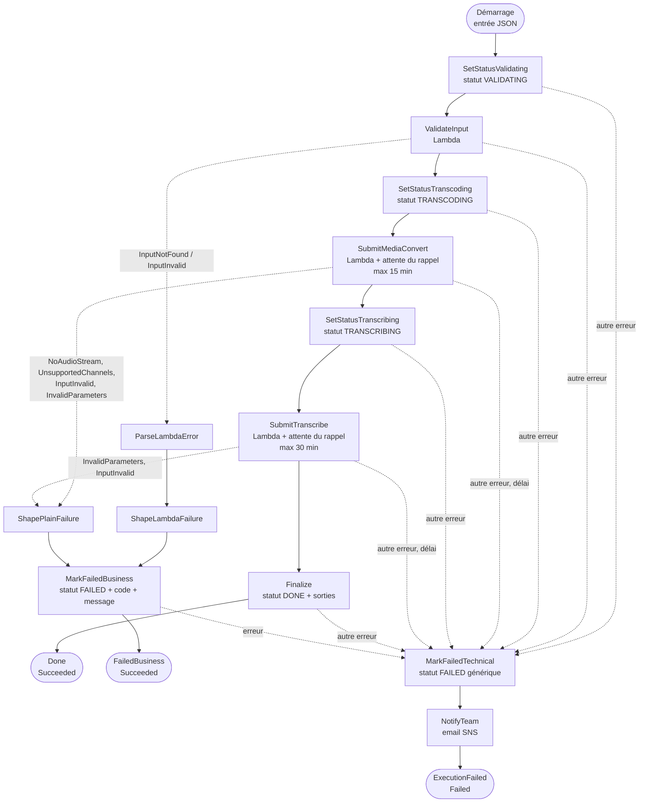
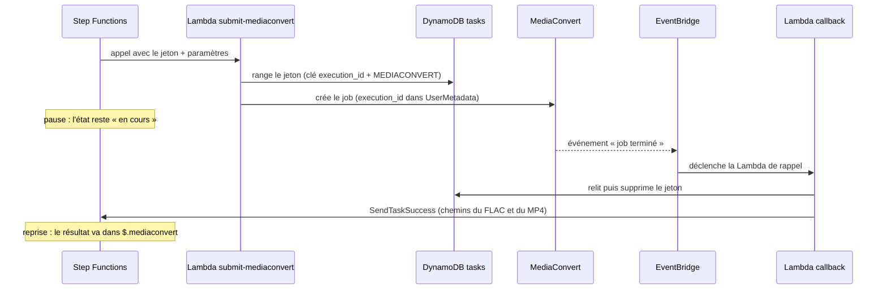

# La state machine, pas à pas

Ce document explique le fichier [`state_machine/pipeline.asl.json.tpl`](../state_machine/pipeline.asl.json.tpl) : le flux de bout en bout, ce que fait chaque état, comment les données circulent, et comment les erreurs sont gérées. À lire avec le fichier ouvert à côté.

## 1. Rôle et vue d'ensemble

La state machine **orchestre** le traitement : elle enchaîne les étapes dans l'ordre, attend la fin des jobs longs, décide quoi faire en cas d'erreur, et tient à jour le statut. Elle ne fait aucun traitement elle-même : le travail est fait par les Lambdas, MediaConvert et Transcribe.

| Élément | Valeur |
|---|---|
| Nom | `<PREFIX>-pipeline` (par défaut `stt-poc-pipeline`) |
| Type | Standard (adapté aux exécutions de plusieurs minutes avec attentes) |
| Langage | Amazon States Language (ASL), un document JSON |
| Durée maximale | 3 600 s (1 heure) pour toute l'exécution |
| Nombre d'états | 16 |

### Le fichier est un modèle (`.tpl`)

Le fichier contient des marqueurs que le script `05_state_machine.sh` remplace avant de créer la state machine :

| Marqueur | Remplacé par | Où dans le fichier |
|---|---|---|
| `__PREFIX__` | `stt-poc` | noms des tables, des Lambdas et du topic SNS |
| `__REGION__` | la région (par exemple `eu-central-1`) | ARN du topic, lien vers la console dans l'alerte |
| `__ACCOUNT_ID__` | votre numéro de compte | ARN du topic |

Le résultat est écrit dans `build/pipeline.asl.json`, c'est ce fichier qui est déployé. Un marqueur oublié bloque le déploiement (le script s'arrête avec une erreur).

## 2. Le vocabulaire en dix lignes

| Terme | Signification |
|---|---|
| **État** (*state*) | Une étape. Chaque état a un nom, un `Type` et (sauf états terminaux) un `Next` |
| `Task` | Appelle un service AWS : une Lambda, DynamoDB, SNS... |
| `Pass` | Transforme des données, sans rien appeler |
| `Succeed` / `Fail` | Terminent l'exécution en réussite / en échec |
| **Entrée de l'exécution** | Le JSON fourni au démarrage. Il devient l'« état courant » (*state input*) que chaque étape lit et enrichit |
| `$.champ` | Chemin JSON : lit `champ` dans l'état courant. Un nom de paramètre qui se termine par `.$` signifie « la valeur est un chemin, pas un texte » |
| `$$.…` | Objet de contexte fourni par Step Functions : `$$.State.EnteredTime` (heure d'entrée dans l'état), `$$.Task.Token` (jeton d'attente), `$$.Execution.Id` (identifiant de l'exécution) |
| `ResultPath` | Où ranger le résultat de l'état dans l'état courant. `"$.validation"` : sous la clé `validation`. `null` : le résultat est jeté |
| `Retry` | Combien de fois et à quel rythme réessayer en cas d'erreur transitoire |
| `Catch` | Où aller si l'erreur persiste (et où ranger le détail de l'erreur) |

## 3. Vue d'ensemble du flux



Trois issues possibles :

| Issue | État final | Statut dans DynamoDB | Email |
|---|---|---|---|
| Succès | `Done` (exécution **réussie**) | `DONE` | non |
| Échec lié au fichier ou aux paramètres | `FailedBusiness` (exécution **réussie**) | `FAILED` avec code et message | non |
| Échec technique | `ExecutionFailed` (exécution **en échec**) | `FAILED` avec message générique | oui |

## 4. Les données qui circulent

L'état courant est un JSON qui **grossit** à mesure que les étapes rangent leur résultat. Exemple avec un fichier réussi.

**Au démarrage** (ce que vous fournissez) :

```json
{
  "execution_id": "demo-1",
  "owner": "poc",
  "input": "s3://stt-poc-123/input/demo/mon-fichier.mp3",
  "stereo_mode": "downmix",
  "transcribe": { "language_code": "fr-FR" }
}
```

**Après `ValidateInput`** : ajout de `validation` (5 champs choisis par `ResultSelector`) :

```json
{
  "execution_id": "demo-1",
  "input": "s3://stt-poc-123/input/demo/mon-fichier.mp3",
  "stereo_mode": "downmix",
  "transcribe": { "language_code": "fr-FR" },
  "validation": {
    "bucket": "stt-poc-123",
    "key": "input/demo/mon-fichier.mp3",
    "input": "s3://stt-poc-123/input/demo/mon-fichier.mp3",
    "extension": "mp3",
    "size_bytes": 1234567
  }
}
```

**Après `SubmitMediaConvert`** : ajout de `mediaconvert`, c'est le résultat envoyé plus tard par la Lambda de rappel :

```json
{
  "mediaconvert": {
    "execution_id": "demo-1",
    "channels": 1,
    "template": "mono",
    "stereo_mode": null,
    "job_id": "1700000000000-abcdef",
    "flac": "s3://stt-poc-123/output/demo-1/mon-fichier_flac48k_mono.flac",
    "playback": "s3://stt-poc-123/output/demo-1/mon-fichier_playback.mp4"
  }
}
```

**Après `SubmitTranscribe`** : ajout de `transcription` :

```json
{
  "transcription": {
    "execution_id": "demo-1",
    "job_name": "stt-poc-demo-1",
    "transcript": "s3://stt-poc-123/transcripts/demo-1/transcript.json"
  }
}
```

`Finalize` lit `mediaconvert.flac`, `mediaconvert.playback` et `transcription.transcript` pour écrire les chemins de sortie dans DynamoDB. Les états `SetStatus*` ne modifient pas l'état courant (`ResultPath: null`).

**En cas d'erreur**, un champ `error` est ajouté : `{ "Error": "<nom>", "Cause": "<détail>" }`, puis `failure` (code et message mis en forme) pour les erreurs liées au fichier.

## 5. Chaque état en détail

### 5.1 Paramètres globaux

```json
"Comment": "STT POC : validation, MediaConvert (FLAC + MP4), Transcribe.",
"StartAt": "SetStatusValidating",
"TimeoutSeconds": 3600,
```

`StartAt` désigne le premier état. `TimeoutSeconds` plafonne toute l'exécution à 1 heure : au-delà, elle s'arrête avec le statut `TIMED_OUT`. Ce cas **ne peut pas être intercepté** par un `Catch`, donc il n'envoie pas d'email dans le POC. Il reste improbable : les deux attentes cumulées (15 + 30 minutes) tiennent dans l'heure.

### 5.2 `SetStatusValidating`, `SetStatusTranscoding`, `SetStatusTranscribing`

Trois états identiques, qui ne diffèrent que par la valeur du statut.

| | |
|---|---|
| Type | `Task` avec l'intégration DynamoDB native (`arn:aws:states:::dynamodb:updateItem`) : aucune Lambda |
| Ce qu'il fait | Met à jour la ligne `execution_id` de la table `<PREFIX>-executions` : `status = VALIDATING` (ou `TRANSCODING`, `TRANSCRIBING`) et `updated_at` = heure d'entrée dans l'état |
| Clé | `execution_id` lu dans l'entrée (`"S.$": "$.execution_id"`) |
| Détail utile | `status` et `error` sont des mots réservés de DynamoDB : on les écrit via des alias (`#s`, `#e` dans `ExpressionAttributeNames`). `UpdateItem` **crée la ligne** si elle n'existe pas : c'est pourquoi un lancement depuis la console fonctionne sans pré-création |
| `ResultPath` | `null` : le résultat de l'appel est jeté, l'état courant ne change pas |
| `Retry` | 3 tentatives sur `States.TaskFailed`, après 2 s, 4 s, 8 s |
| `Catch` | Toute erreur va vers `MarkFailedTechnical` |

Ces statuts sont ce qui permet de montrer l'avancement dans DynamoDB pendant une démonstration.

### 5.3 `ValidateInput`

| | |
|---|---|
| Type | `Task`, appel synchrone de la Lambda `<PREFIX>-validate-input` |
| Entrée envoyée | `execution_id` et `input` |
| Ce que fait la Lambda | Vérifie l'adresse S3, le bucket autorisé, l'extension, l'existence et la taille du fichier |
| Résultat | `ResultSelector` ne garde que 5 champs de la réponse (`bucket`, `key`, `input`, `extension`, `size_bytes`), rangés sous `$.validation` |
| `Retry` | 3 tentatives sur les erreurs de service Lambda (`Lambda.ServiceException`, `Lambda.AWSLambdaException`, `Lambda.SdkClientException`, `Lambda.TooManyRequestsException`) et sur `ClientError` (problème S3 transitoire) |
| `Catch` 1 | `InputNotFound`, `InputInvalid` : erreurs **liées au fichier** > `ParseLambdaError` |
| `Catch` 2 | Toute autre erreur : **technique** > `MarkFailedTechnical` |

### 5.4 `SubmitMediaConvert` : l'attente d'un job

C'est l'état le plus important à comprendre. Il combine un appel de Lambda et une **pause** jusqu'à la fin du job MediaConvert.

```json
"Resource": "arn:aws:states:::lambda:invoke.waitForTaskToken",
"Payload": { "task_token.$": "$$.Task.Token", ... }
```

Le suffixe `.waitForTaskToken` change le comportement : Step Functions appelle la Lambda, puis **ne passe pas à l'état suivant** tant que quelqu'un n'a pas « rendu » le jeton (`$$.Task.Token`) par un appel `SendTaskSuccess` ou `SendTaskFailure`. Pendant l'attente, rien ne tourne et rien n'est facturé.



| | |
|---|---|
| Entrée envoyée | `execution_id`, `task_token`, `bucket` et `key` (issus de `$.validation`), `stereo_mode`, `transcribe` |
| Ce que fait la Lambda | Détecte mono ou stéréo avec `ffprobe`, choisit le template, range le jeton, crée le job |
| Résultat | Ce que la Lambda de rappel envoie dans `SendTaskSuccess`, rangé sous `$.mediaconvert` |
| `TimeoutSeconds` | **900** : si le jeton n'est pas rendu en 15 minutes, l'état échoue avec `States.Timeout` |
| `Retry` | 3 tentatives sur les erreurs de service Lambda uniquement |
| `Catch` 1 | `InvalidParameters`, `InputInvalid`, `NoAudioStream`, `UnsupportedChannels` > `ShapePlainFailure` (erreurs liées au fichier ou aux paramètres, signalées par la Lambda avec `SendTaskFailure`) |
| `Catch` 2 | Tout le reste (dont `States.Timeout`) > `MarkFailedTechnical` |

Pourquoi le jeton est-il rangé dans DynamoDB ? Parce que le rappel vient d'un autre composant (la Lambda de rappel, déclenchée par EventBridge) qui ne connaît que l'`execution_id` (présent dans les événements) : la table fait le lien entre `execution_id` et jeton.

### 5.5 `SubmitTranscribe`

Même mécanisme que `SubmitMediaConvert`, pour le job Transcribe.

| | |
|---|---|
| Entrée envoyée | `execution_id`, `task_token`, `flac` (= `$.mediaconvert.flac`), `template` (= `$.mediaconvert.template`), `transcribe` |
| Ce que fait la Lambda | Construit la requête Transcribe (langue, locuteurs, canaux...), range le jeton, lance le job `<PREFIX>-<execution_id>` |
| Résultat | Rangé sous `$.transcription` (chemin de la transcription) |
| `TimeoutSeconds` | **1800** (30 minutes) |
| `Catch` 1 | `InvalidParameters`, `InputInvalid` > `ShapePlainFailure` (par exemple langue ou vocabulaire refusé par Transcribe) |
| `Catch` 2 | Tout le reste > `MarkFailedTechnical` |

La valeur `template` sert à décider d'activer l'identification de canaux (uniquement pour `stereo-keep`).

### 5.6 `Finalize` et `Done`

`Finalize` écrit dans DynamoDB : `status = DONE`, `updated_at` et `outputs` (une structure avec `flac`, `playback`, `transcript`). `Done` est un état `Succeed` : l'exécution se termine en réussite.

## 6. Les erreurs

### 6.1 Deux familles

| Famille | Cause | Que voit l'utilisateur | Que fait l'équipe |
|---|---|---|---|
| **Liée au fichier ou aux paramètres** (« métier ») | Fichier absent, illisible, sans piste audio, paramètres incompatibles | Statut `FAILED` avec **code et message précis** | Rien : pas d'alerte |
| **Technique** | Panne, délai dépassé, erreur imprévue | Statut `FAILED` avec un message **générique** | Reçoit un **email** |

| Erreur | Vient de | Famille |
|---|---|---|
| `InputNotFound` | `ValidateInput` (fichier introuvable) | métier |
| `InputInvalid` | `ValidateInput` (extension, bucket, fichier vide) ou `SubmitMediaConvert` (média illisible) ou `SubmitTranscribe` (adresse invalide) | métier |
| `NoAudioStream` | `SubmitMediaConvert` (aucune piste audio) | métier |
| `UnsupportedChannels` | `SubmitMediaConvert` (plus de 2 canaux) | métier |
| `InvalidParameters` | `SubmitMediaConvert` ou `SubmitTranscribe` (par exemple `keep` avec `max_speaker_labels`, vocabulaire inexistant) | métier |
| `States.Timeout` | Une attente de rappel a dépassé son délai | technique |
| Toute autre erreur (exception d'une Lambda, DynamoDB, SNS...) | N'importe où | technique |

La règle du `Catch` : on liste d'abord les erreurs métier connues, puis `States.ALL` (tout le reste) pour la voie technique.

### 6.2 Voie « liée au fichier »

Deux chemins selon la façon dont l'erreur arrive.

**Depuis `ValidateInput`** (la Lambda a levé une exception) : la cause est un JSON produit par Lambda, avec le message dans `errorMessage`.

```
ParseLambdaError  >  ShapeLambdaFailure  >  MarkFailedBusiness  >  FailedBusiness
```

- `ParseLambdaError` (`Pass`) : `States.StringToJson($.error.Cause)` transforme le texte JSON en objet, rangé sous `$.parsed`.
- `ShapeLambdaFailure` (`Pass`) : fabrique `failure = { code: <nom de l'erreur>, message: <errorMessage> }`.

**Depuis `SubmitMediaConvert` ou `SubmitTranscribe`** : ces Lambdas signalent elles-mêmes l'erreur avec `SendTaskFailure`, et la cause est déjà un texte lisible.

```
ShapePlainFailure  >  MarkFailedBusiness  >  FailedBusiness
```

- `ShapePlainFailure` (`Pass`) : fabrique `failure = { code: <nom>, message: <cause> }` directement.

Les deux chemins se rejoignent sur `MarkFailedBusiness` : écrit dans DynamoDB `status = FAILED` et `error = { code, message }`. `FailedBusiness` est un état `Succeed` : **l'exécution est « réussie »**. C'est volontaire : un fichier invalide n'est pas une panne, et ne doit pas apparaître comme une exécution en échec (en production, cela évite de déclencher des alarmes sur l'indicateur « exécutions en échec »).

### 6.3 Voie technique

```
MarkFailedTechnical  >  NotifyTeam  >  ExecutionFailed
```

- `MarkFailedTechnical` : écrit `status = FAILED` et un message **fixe** (`ProcessingFailed` / « An internal error occurred while processing the file. »). Le détail de la panne n'est pas exposé à l'utilisateur.
- `NotifyTeam` : publie sur le topic SNS un message avec l'identifiant de l'exécution, le fichier, l'erreur, la cause et un **lien direct vers l'exécution** dans la console. `States.Format('... {} ...', valeur1, valeur2, ...)` remplit les `{}` dans l'ordre.
- `ExecutionFailed` (`Fail`) : termine l'exécution **en échec**, en reprenant l'erreur d'origine (`ErrorPath` / `CausePath` pointent vers `$.error.Error` et `$.error.Cause`).

Précautions intégrées : si l'écriture du statut échoue (`MarkFailedTechnical`), l'alerte part quand même (son `Catch` mène à `NotifyTeam`) ; si l'envoi de l'email échoue, l'exécution se termine tout de même en échec.

### 6.4 Réessais

| États | Erreurs réessayées | Tentatives |
|---|---|---|
| `SetStatus*`, `Finalize`, `MarkFailed*`, `NotifyTeam` | `States.TaskFailed` | 3, après 2 s, 4 s, 8 s |
| `ValidateInput` | erreurs de service Lambda et `ClientError` | 3, mêmes délais |
| `SubmitMediaConvert`, `SubmitTranscribe` | erreurs de service Lambda | 3, mêmes délais |

Un job MediaConvert ou Transcribe **en échec n'est jamais rejoué** : la cause est le plus souvent liée aux données (fichier corrompu, paramètre refusé), rejouer ne changerait rien.

## 7. Les délais

| Où | Valeur | Conséquence d'un dépassement |
|---|---|---|
| `SubmitMediaConvert` | 900 s | `States.Timeout` > voie technique (email) |
| `SubmitTranscribe` | 1 800 s | idem |
| Toute l'exécution | 3 600 s | arrêt `TIMED_OUT`, sans email dans le POC |

Ces délais protègent d'un événement de fin perdu : sans eux, l'exécution attendrait indéfiniment. Ils sont volontairement courts pour le POC ; pour des fichiers longs, il faut les augmenter (en production : 1 h, 2 h, 4 h).

## 8. Quelques scénarios de bout en bout

**Succès (fichier mono, 1 minute)**
`SetStatusValidating` > `ValidateInput` > `SetStatusTranscoding` > `SubmitMediaConvert` (pause quelques dizaines de secondes à quelques minutes) > `SetStatusTranscribing` > `SubmitTranscribe` (pause) > `Finalize` > `Done`. Statut final `DONE`.

**Fichier introuvable**
`SetStatusValidating` > `ValidateInput` lève `InputNotFound` > `ParseLambdaError` > `ShapeLambdaFailure` > `MarkFailedBusiness` > `FailedBusiness`. Exécution réussie, statut `FAILED` (`InputNotFound`), pas d'email, aucune ressource coûteuse utilisée.

**Fichier qui n'est pas un média**
Passe `ValidateInput`, puis `SubmitMediaConvert` : `ffprobe` échoue, la Lambda signale `InputInvalid` par `SendTaskFailure` > `ShapePlainFailure` > `MarkFailedBusiness` > `FailedBusiness`.

**Panne technique à la validation**
`ValidateInput` lève une erreur non prévue > `Catch` 2 > `MarkFailedTechnical` > `NotifyTeam` (email) > `ExecutionFailed`.

**Événement de fin jamais reçu**
`SubmitMediaConvert` reste en pause 900 s > `States.Timeout` > voie technique (email). Le job MediaConvert, lui, a pu se terminer normalement : le problème est du côté d'EventBridge ou de la Lambda de rappel.

**Rappel qui échoue côté MediaConvert**
Le job est en erreur > la Lambda de rappel envoie `SendTaskFailure` (`MediaConvertJobFailed`) > l'état échoue > voie technique (email).

## 9. Statut Step Functions et statut métier : ne pas confondre

| Situation | État de l'exécution (Step Functions) | `status` dans DynamoDB |
|---|---|---|
| Succès | Succeeded | `DONE` |
| Échec lié au fichier | **Succeeded** | `FAILED` |
| Échec technique | **Failed** | `FAILED` |
| En cours | Running | `VALIDATING`, `TRANSCODING` ou `TRANSCRIBING` |

Pour savoir si un traitement a réussi, lire le statut dans DynamoDB. L'état de l'exécution Step Functions ne dit pas si le fichier a été traité : il dit si le **pipeline** a fonctionné.

## 10. Modifier la state machine

Après modification du `.tpl`, redéployer : `bash scripts/05_state_machine.sh` (il contrôle d'abord la structure et signale un état inexistant, un état orphelin ou une attente sans délai).

**Changer un délai** : modifier `TimeoutSeconds` de l'état concerné.

**Ajouter un email de succès** : insérer cet état (le rôle de la state machine a déjà le droit de publier sur le topic) et faire pointer `"Next"` de `Finalize` vers `NotifySuccess` au lieu de `Done` :

```json
"NotifySuccess": {
  "Type": "Task",
  "Resource": "arn:aws:states:::sns:publish",
  "Parameters": {
    "TopicArn": "arn:aws:sns:__REGION__:__ACCOUNT_ID__:__PREFIX__-alerts",
    "Subject": "STT pipeline : traitement terminé",
    "Message.$": "States.Format('Traitement terminé | execution_id: {} | transcription: {}', $.execution_id, $.transcription.transcript)"
  },
  "ResultPath": null,
  "Next": "Done"
}
```

**Réessayer plus longtemps un quota Transcribe** : ajouter, dans le `Retry` de `SubmitTranscribe`, une entrée avec les erreurs concernées et un `IntervalSeconds` plus long. À essayer d'abord sur un traitement de test.

## 11. Ce qui reste à confirmer sur un compte réel

| Point | Pourquoi |
|---|---|
| Une exception levée par une Lambda dans une étape `.waitForTaskToken` fait-elle échouer l'étape immédiatement ? | Hypothèse de conception. Sinon, l'échec n'apparaît qu'au délai de l'étape. Les erreurs « liées au fichier » ne sont pas concernées : elles passent par `SendTaskFailure` |
| Le format de `Cause` des erreurs d'une Lambda (JSON avec `errorMessage`) | Utilisé par `ParseLambdaError`. Si le format diffère, ce seul état est à adapter |
| Le message d'alerte avec une cause contenant des caractères spéciaux | `States.Format` insère le texte tel quel ; à surveiller si l'email arrive tronqué |
